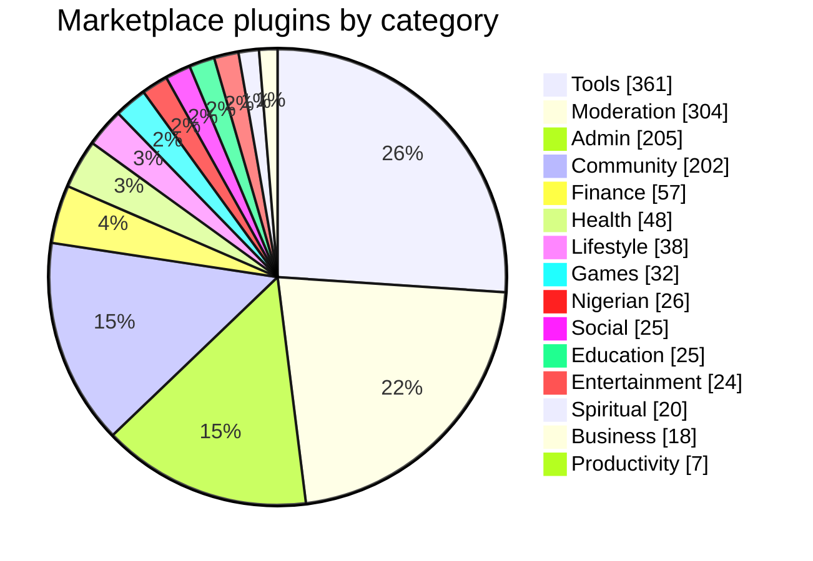

<div align="center">


<br/>

[](#-whats-new--v128_jt)
[](https://nodejs.org)
[](https://github.com/WhiskeySockets/Baileys)
[](#-auto-update)
[](#-quick-start)
[](LICENSE)

### The WhatsApp bot built for group owners, communities and businesses

**[🚀 Quick Start](#-quick-start)** &nbsp;·&nbsp; **[✨ Highlights](#-highlights)** &nbsp;·&nbsp; **[📚 Features](#-features)** &nbsp;·&nbsp; **[🛒 Marketplace](#-marketplace)** &nbsp;·&nbsp; **[🔄 Updates](#-auto-update)** &nbsp;·&nbsp; **[❓ FAQ](#-faq)** &nbsp;·&nbsp; **[🤝 Support](#-support)**

<br/>


</div>

<p align="center"></p>

## ✨ Highlights

<table>
<tr>
<td width="33%" valign="top" align="center">

### 🛡️ Group Protection
Ban, kick, mute and warn with auto-kick at your limit. Anti-link, anti-spam and anti-forward keep your group clean.

</td>
<td width="33%" valign="top" align="center">

### 🤖 Claude AI Chatbot
Natural conversations with per-user memory, a deep-think mode for hard questions, and optional voice-note replies.

</td>
<td width="33%" valign="top" align="center">

### 🖥️ Web Dashboard
Set up and manage your bot from the browser — no terminal needed after the first start.

</td>
</tr>
<tr>
<td width="33%" valign="top" align="center">

### ⚽ Live Sports
Live scores, league tables, fixtures, top scorers and player profiles across the major leagues.

</td>
<td width="33%" valign="top" align="center">

### 🎮 Games Hub
Truth or Dare, trivia, word games, duels, auctions and more to keep your members engaged.

</td>
<td width="33%" valign="top" align="center">

### 📱 Automation
Welcome and goodbye messages, gate verification, scheduled messages, auto-read and ghost mode.

</td>
</tr>
<tr>
<td width="33%" valign="top" align="center">

### 📊 Analytics &amp; CRM
Contact tags, lead scoring, drip campaigns, engagement heatmaps, XP levels and leaderboards.

</td>
<td width="33%" valign="top" align="center">

### ☁️ Google Sync
Save WhatsApp contacts to Google Contacts and export to Google Sheets, with multi-account support.

</td>
<td width="33%" valign="top" align="center">

### 🛒 1,392 Plugins
Hot-install plugins from the marketplace in seconds — no restart, no downtime.

</td>
</tr>
</table>

<p align="center"></p>

## 🚀 Quick Start

<p align="center"></p>

> [!IMPORTANT]
> **Requirements:** Node.js **22 or newer**, a WhatsApp number (a dedicated bot number is recommended) and internet access on the server.

### Option A — Pterodactyl or any Node.js host

1. Upload the files from this repository (`index.js`, `package.json`) to your server's main folder.
2. Set the startup file to **`index.js`**.
3. Start the server.

That's all — there is nothing to configure.

> [!NOTE]
> The **first start takes a few minutes** while Miss Chatra downloads itself and installs its dependencies. Every start after that takes seconds.

### Option B — VPS

```bash
git clone https://github.com/JusticeTech/miss-chatra-bot.git
cd miss-chatra-bot
npm start

# or with PM2 (recommended — restarts automatically):
pm2 start index.js --name "miss-chatra"
```

### After the first start

| | What to do |
|:--:|---|
| **1** | The console prints a **setup link** — open it in your browser |
| **2** | Enter your **email**, choose a **password**, then enter your **WhatsApp number** |
| **3** | In WhatsApp go to **Linked Devices → Link with phone number** and enter the pairing code |
| **4** | Open your inbox and **verify your email** |
| **5** | WhatsApp sends you a message: reply **1** or **2** to choose how the connection is handled |
| **6** | Miss Chatra goes live and sends a welcome message 🎉 |

> [!TIP]
> Until you reply **1** or **2** the bot stays silent and ignores commands — that's intentional, so nothing can run on a half-finished setup. Expired code or wrong number? Use the **Regenerate code** or **Back** button on the pairing screen.

<p align="center"></p>

## 📋 Features

<details>
<summary><b>🛡️ Group Moderation</b> — Full control over your WhatsApp groups</summary>

| Command | Description |
|---------|-------------|
| `/ban @user` | Permanently ban + revoke invite |
| `/kick @user` | Remove from group |
| `/mute @user 30m` | Auto-delete their messages |
| `/warn @user` | Issue warning (auto-kick at limit) |
| `/antilink delete/warn/kick` | Auto-handle invite links |
| `/antispam on` | Auto-mute spammers |
| `/promote @user` | Make group admin |
| `/demote @user` | Remove admin status |
| `/open` / `/close` | Open/close group messaging |
| `/tagall <msg>` | Tag all members |
| `/ghosttag <msg>` | Tag silently |
| `/bulkkick` | Remove multiple members |
| `/bulkmute` | Mute multiple members |

</details>

<details>
<summary><b>🤖 AI & Chatbot</b> — Powered by Claude AI</summary>

| Feature | Description |
|---------|-------------|
| `/chatbot on` | Enable AI chatbot |
| `/claude <question>` | Ask Claude AI directly |
| `/chatra <question>` | Miss Chatra's AI persona |
| `/addcustom` | Train custom responses |
| `/chatbotmemory` | Per-user memory |
| `/apistatus` | Check AI API status |
| `/bugdetect` | Auto-detect bug reports |
| Deep Think Mode | Complex reasoning for hard questions |
| TTS Voice Replies | AI responds in voice notes |

</details>

<details>
<summary><b>⚽ Sports & Live Scores</b> — Real-time football data</summary>

| Command | Description |
|---------|-------------|
| `/livescore` | Live scores across all top leagues |
| `/livescore ucl` | UEFA Champions League live |
| `/livescore epl` | Premier League scores |
| `/table epl` | League standings |
| `/topscorer epl` | Top goal scorers |
| `/topassist epl` | Top assisters |
| `/fixture epl` | Upcoming fixtures |
| `/player <name>` | Player stats & profile |

**Full match details:** Goal scorers, yellow/red cards, substitutions, penalties

</details>

<details>
<summary><b>🎮 Games Hub</b> — Engage your group members</summary>

- Truth or Dare
- Riddles & Trivia  
- Word games (Last Letter, Alphabet Game)
- Math challenges (EmojiMath)
- Geography Race
- 20 Questions
- Blind Auction
- Crypto Price Guess
- Dare Wheel (Spin & Dare)
- Duel (1v1 challenges)

</details>

<details>
<summary><b>📱 WhatsApp Automation</b></summary>

| Feature | Description |
|---------|-------------|
| `/ghost on` | Full invisible mode (no blue ticks, no last seen) |
| `/autoread on` | Auto-read all messages |
| `/autotype on` | Show typing indicator |
| `/antiforward` | Block forwarded messages |
| `/antinsfw on` | Auto-delete inappropriate content |
| `/greetings on` | Welcome new members |
| `/goodbye on` | Goodbye messages |
| `/gate on` | Gate verification (join questions) |
| `/schedule <time> <msg>` | Schedule messages |
| `/broadcast <msg>` | Broadcast to all contacts |

</details>

<details>
<summary><b>📊 Analytics & CRM</b> — Business features</summary>

- Contact management with tags
- Lead scoring system
- Campaign manager with drip sequences
- Revenue tracking
- Engagement heatmaps
- Growth charts
- XP leveling + leaderboard
- Member activity reports
- Lost leads recovery

</details>

<details>
<summary><b>☁️ Google Integration</b></summary>

- **Google Contacts** sync — auto-save WhatsApp contacts
- **Google Sheets** sync — export contact data
- Multi-account support
- OAuth2 authentication
- Automatic token refresh

</details>

<details>
<summary><b>🔧 Bot Management</b></summary>

| Command | Description |
|---------|-------------|
| `/restart` | Restart the bot |
| `/update` | Update to the latest version & restart |
| `/checkupdate` | Check if update is available |
| `/setprefix !` | Change command prefix |
| `/setbotname` | Change bot display name |
| `/mode private/public/group` | Change bot access mode |
| `/ping` | Check bot latency |
| `/runtime` | Bot uptime stats |
| `/sessionbackup` | Backup WhatsApp session |
| `/sessionrestore` | Restore session |
| `/menustyle 1-20` | Change menu theme |
| `/groupid` | Get the current group's JID |
| `/channelid` | Get the current channel's JID (run inside the channel) |
| `/communityid` | Get the community (parent group) ID this group is linked to |
| `/device` | See which linked-device slot sent a message |

</details>

<p align="center"></p>

## 📝 What's New — v1.2.8_JT

> [!NOTE]
> Full release notes are posted in the [JusticeTech channel](https://whatsapp.com/channel/0029VaoLagu3hRFKWlqk9W2T).

| | |
|---|---|
| 🆕 | **Web dashboard** — set up and manage your bot from the browser |
| 🆕 | **Email verification** during setup; the bot goes live only after you confirm your connection choice on WhatsApp |
| 🆕 | **Regenerate code** and **Back** buttons on the pairing screen |
| 🆕 | **Sub-bots** — deploy an extra bot with a single command |
| 🆕 | **Faster menu** — built once and cached, so `/menu` opens instantly even with hundreds of plugins |
| 🆕 | `/sleep` and `/wake`, `/linkchannel`, `/linkgroup` and auto-forward to a channel or group |
| 🆕 | **Automatic updates** every few hours |
| 🛠️ | Fixed the chatbot "No response" issue, YouTube search crashes on incomplete results, and empty-message sending |
| 🗑️ | Removed Post Status and Auto-View Status |

<p align="center"></p>

## 🛒 Marketplace

Miss Chatra has **1,392 installable plugins** across 15 categories:



### How to install a plugin

| | Step |
|:--:|---|
| **1** | **Join** both JusticeTech communities: [Tools &amp; Updates](https://chat.whatsapp.com/GL6GUJL5QNJEuBy9fWIssu?mode=gi_t) and [Support Group](https://chat.whatsapp.com/Gyt75qFHoul3wp53IKi25v?mode=gi_t) |
| **2** | **Request** it in the Support group: `/plugin request <plugin_id> <your_bot_number> <reason>` |
| **3** | **Install** after approval: `/plugin install <plugin_id>` |

> [!TIP]
> ⚡ Plugins install instantly — no restart needed.

> [!WARNING]
> 🔒 Install, enable and remove are owner-only. Installed plugin code runs with the same access as any built-in feature — only install plugins you trust.

<p align="center"></p>

## 🔄 Auto-Update

Miss Chatra keeps itself up to date. It checks for new versions every few hours and restarts on the new version automatically. You can also update on demand from WhatsApp:

```bash
/checkupdate     # see whether an update is available
/update          # update now and restart
```

> [!NOTE]
> Your settings, WhatsApp session, database and installed plugins are **never** touched by an update.

## 📁 What's in this repository

```
miss-chatra-bot/
├── index.js         # Starts Miss Chatra and keeps it up to date
├── package.json
├── assets/          # README artwork
├── thumbnail/       # Bot profile image
├── LICENSE
└── README.md
```

Everything else is downloaded automatically on first start and refreshed on every update.

<p align="center"></p>

## ❓ FAQ

<details>
<summary><b>Do I need to configure anything?</b></summary>

No. Upload the files, set the startup file to `index.js` and start. The setup link in the console walks you through the rest.

</details>

<details>
<summary><b>Will an update log me out or delete my data?</b></summary>

No. Your WhatsApp session, database, settings and installed plugins are kept separate from the bot code and are never overwritten.

</details>

<details>
<summary><b>What if something goes wrong during an update?</b></summary>

If a new version keeps crashing, Miss Chatra automatically goes back to the last working version. If the internet is down at start-up, it simply runs the version you already have.

</details>

<details>
<summary><b>The bot doesn't answer any commands right after linking.</b></summary>

That's expected until you finish setup: verify your email, then reply **1** or **2** to the message the bot sends you on WhatsApp. After that, commands work.

</details>

<details>
<summary><b>The console says "Waiting for approval…"</b></summary>

New installs are sometimes reviewed before they're activated. Keep the server running — Miss Chatra starts by itself as soon as your install is approved.

</details>

<details>
<summary><b>Which Node.js version do I need?</b></summary>

Node.js **22 or newer**. On Pterodactyl, pick a Node 22+ image in the server's startup settings.

</details>

<details>
<summary><b>Where do I get help or request a plugin?</b></summary>

Join the Support Group below — that's also where plugin requests are handled.

</details>

<p align="center"></p>

## 🤝 Support

<div align="center">

| Resource | Link |
|----------|------|
| 📡 **JusticeTech Channel** | [Follow for updates](https://whatsapp.com/channel/0029VaoLagu3hRFKWlqk9W2T) |
| 🔧 **Tools &amp; Updates** | [Join community](https://chat.whatsapp.com/GL6GUJL5QNJEuBy9fWIssu?mode=gi_t) |
| 💬 **Support Group** | [Get help &amp; request plugins](https://chat.whatsapp.com/Gyt75qFHoul3wp53IKi25v?mode=gi_t) |

</div>

## 📜 License

[MIT](LICENSE) — © 2025–2026 JusticeTech, Nigeria 🇳🇬

<p align="center"></p>
